# Swoovr strategy and launch model

> Implementation update, 18 October 2026: the corporate website now has a PostgreSQL signup implementation prepared locally. Descriptions of the old email-only/current shared infrastructure below are the earlier research snapshot. See [setup](../supabase-setup.md) and the repository README for the current contract and deployment status.
Prepared 18 October 2026. [Pack index and evidence labels](README.md).

## A. Executive go-to-market recommendation

Swoovr should become a credible, locally useful alternative for Adelaide adults who want clearer intentions and more control over meeting people. Begin with listening, a city-qualified waitlist and a visible founder. Recruit connected groups through trusted organisers, invite them into the product together, and prove that they find relevant people and return. Increase acquisition only when the experience can absorb it.

The commercial challenge is not a shortage of dating apps. It is persuading people to spend attention, disclose personal information and risk rejection on an unfamiliar service whose local usefulness is initially uncertain. A polished brand and a gold badge cannot solve an empty discovery screen. Marketing must therefore organise participation as well as generate awareness.

### The first audience and promise

**DEFAULT:** use dating with clearer intentions as the first acquisition proposition. Test the message with Adelaide adults aged 25–39 who can comfortably meet in the CBD and inner suburbs. This is a research and recruitment focus, not an exclusion of other adults or a claim that this segment is proven. Run smaller parallel discovery interviews with adults aged 18–24, 40–54 and 55+, queer communities, people with disability, culturally diverse adults and people seeking friendship. Select the first viable beta group from evidence about reciprocal demand, not founder assumptions about attractiveness or who pays.

“Meaningful” should mean a connection consistent with both people's stated intentions. It must not imply that only long-term monogamous relationships are legitimate. Casual dating can be intentional; friendship must never be used as a route to unsolicited romantic contact. Keep modes and permission boundaries explicit.

Friendship, dating, casual connections and broad social discovery each introduce distinct compatibility and moderation needs. Launching them all together multiplies the cold-start problem. If interviews and applications demonstrate a stronger friendship use case, change the first use case before spending. An inclusive brand can open functionality in stages while communicating exactly who the current beta can serve.

Suggested positioning to test:

> Swoovr is being built in Adelaide for adults who want to be clearer about what they want—and more deliberate about who they meet.

This is a development statement. Replace it with a demonstrated benefit only once the product supports it.

### Positioning alternative recovered from the second draft

The unfinished ChatGPT response proposed **“Connect on your terms.”** Retain it as a testable alternative, not an approved replacement for “Your kind of connection.” The former emphasises agency; the latter expresses warmth and breadth. Neither explains the category or Adelaide-first status on its own. Test each with the same concrete dating/Adelaide explanation and compare comprehension, qualified local interest and later activation—not just which slogan people like.

“On your terms” must not imply unlimited choice, guaranteed matches or completed privacy controls. Use development language until the relevant controls are implemented and tested. The [incorporation review](05-other-draft-review.md) explains other decisions from the second draft.

### Is Adelaide the right first city?

**Yes, conditionally.** Greater Adelaide had 1,491,015 residents at June 2025. That is sufficient scale for a local experiment, but it is not Swoovr's reachable audience or a count of available adults. Geographic concentration and the team's ability to show up locally are stronger reasons to start here than population alone. [ABS regional population, released 31 March 2026](https://www.abs.gov.au/statistics/people/population/regional-population/2024-25).

Adelaide makes sense if RePass Cloud can recruit organisers, run interviews and support users locally. Its smaller population also makes fragmented intentions and preferences more consequential. Do not treat the entire metropolitan area as one convenient dating radius: travel time from the outer north to the south matters. Begin with a CBD/inner-suburban meeting area, ask people about comfortable travel, and admit broader areas as compatible participation improves.

Run a six-week validation period before committing substantial spend. Seek 20–30 interviews, three credible recruitment partners and a first group willing to attend the same onboarding period. These are operating hypotheses. If two materially different recruitment approaches and messages fail to produce that interest, diagnose the proposition, trust and access problem. Do not automatically abandon Adelaide for a bigger city or compensate with cheap global registrations.

### What is worth marketing?

| Proposed differentiator | Commercial assessment | Evidence needed before advertising as available |
| --- | --- | --- |
| Intentions and reciprocal discovery rules | Strong candidate: addresses wasted effort; filters alone are easy to copy | People understand the rules, see relevant people and receive fewer unwanted contacts in beta |
| Visibility/contact controls | Strong candidate, especially in a smaller city | Tests show each control works across search, recommendations, notifications and paid access |
| Separate identity and photo checks | Useful trust explanation; verification is not unique | Working checks, clear badge meanings, accessibility alternatives, appeals and data handling |
| Transparent verification information | Potentially valuable if understandable | Users can explain what each check establishes and what it does not |
| Anti-bot/impersonation measures | Essential operating capability; weak as a sweeping promise | Measured detection, reporting and response; no “bot-free” or “everyone is real” claim |
| Incognito | Relevant but easy to overpromise | A precise specification and tests; explain any unavoidable exposure; never promise absolute invisibility |
| Inclusion across identities and intentions | Necessary brand behaviour, not proof of adequate local options | Research, usable settings, moderation and acceptable experience across served groups |
| Venue partnerships/date experiences | Good local acquisition and activation experiment | Written partner agreement, staffed delivery, accessible options, clear booking/refund terms |
| Human-led support | Tangible early differentiator if funded | Named coverage hours, ownership, escalation and measured response times; no unsupported 24/7 claim |
| Fair Free/Plus/Premium value | Valuable once prices and benefits are real | Free users can experience the core connection loop; clear entitlements, billing and cancellation |
| User feedback/accountability | High abuse, retaliation and privacy risk | Private, actionable reporting and appeals; avoid public person ratings or anonymous reputation scores |

Competitors already market verification, intentions and real-world connection. The credible distinction is how Swoovr combines and delivers these capabilities locally, rather than claiming to have invented them. Apple also identifies dating as a crowded category and expects a meaningfully different or improved experience; app review differentiation belongs on the critical path. [Apple review guidelines, 4.3](https://developer.apple.com/app-store/review/guidelines/).

## B. Prioritised channel strategy

Time estimates below are weekly incremental work, with reuse already assumed. Cash ranges are planning allowances in AUD, not vendor quotes. Do not add every row together: choose a channel mix within the budget in section I.

| Channel | Phase / priority | Purpose and adult audience fit | Cadence / engagement | Cash and effort | Decision |
| --- | --- | --- | --- | --- | --- |
| Instagram | 1 onward / P0 | Visual identity, local discovery, founder credibility, partner collaboration | 3 feed items/week including 1–2 captioned Reels; Stories 3 days/week; replies on business days | Organic A$0; 3–4 h/week | Main active social channel |
| Local organisers, venues and community partnerships | 2 onward / P0 | Recruit groups who can participate together; trust and local relevance | 5 tailored approaches/week, 2 conversations; organisers share only with permission | A$0–250/month initially; 3–4 h/week | Main recruitment channel |
| Consented email | 1 onward / P0 | Turn interest into applications, invitations and activation | Monthly while distant from beta; targeted milestone messages; business-day replies | A$0–75/month allowance; 1–2 h/week | Essential after delivery/suppression infrastructure |
| Facebook Page and permitted groups | 1–2 / P1 | Local events and broader adult age coverage | Repurpose 2 posts/week; request group-admin permission; no member scraping | A$0 organic; 0.5–1 h/week | Establish Page; use a few relevant groups |
| Reddit | 1–2 / P1 | Transparent discussion, product questions and feedback; no presumed local reach | Up to 1 substantial own-community update/week; helpful replies; external posts only when permitted | A$0 organic; 1–2 h/week moderation | Small, clearly official information community if moderation is resourced |
| Founder LinkedIn plus company Page | 1 / P1 | Business credibility, founder story, partners, press and hiring | Founder post fortnightly; company milestone monthly | Free basic Page; 0.5 h/week | Useful supporting presence, not primary consumer acquisition |
| TikTok | 2–3 / P2 | Test discovery among younger adults with native short video | Pilot 2 videos/week for 4 weeks, adapted from founder recordings; review local applications | A$0 organic; 1–2 extra h/week | Add only if Instagram workload is sustainable |
| YouTube | 3–4 / P2 | Searchable walkthroughs and trust explanations | 1 captioned demo/month; reuse selected Shorts | A$0 organic; 2–4 h per demo | Library rather than a separate entertainment channel |
| X / Twitter | 1 / P2 | Existing-account hygiene, founder/product milestones | 1 update/week at most; answer direct relevant enquiries | A$0; 15–30 min/week | Reserve/maintain; low acquisition priority |
| Threads | 2 / P2 | Low-cost conversational extension of Instagram | 1–2 adapted posts/week if useful responses occur | A$0; 30 min/week | Optional experiment, stop if no relevant conversations |
| Bluesky | 1 / P3 | Handle protection and a clear official link | Profile plus material milestones | A$0; minimal | No regular publishing commitment initially |
| Snapchat | 5 / P3 | Possible younger-adult reach; extra creative and age-control burden | No initial programme | A$0 allocated | Defer until another channel proves acquisition economics |
| Search/SEO | 1 onward / P1 | Brand verification and specific Adelaide/product questions | Useful FAQ plus 1 substantive update/month | A$0 media; 2–4 h/month | Focus on branded trust and useful content |
| Paid Meta or Google | 3–5 / P2 | Controlled local acquisition once eligible | One platform at a time; weekly qualified-cohort review | Ring-fenced in section I; 2–3 h/week during tests | Conditional on policy clearance and a working funnel |
| Creators | 2–5 / P1 | Trusted access to adult local communities | One small paid/disclosed pilot at a time | Negotiate scope; A$100–500 pilot allowance | Prefer local audience evidence to follower totals |

### Reach and the limits of audience estimates

DataReportal's Digital 2026 report uses late-2025 national advertising data: Instagram 15.2m, Facebook 17.7m, YouTube 21.0m, TikTok 10.9m adults, Snapchat 8.17m, LinkedIn 18.0m registered members and X 4.74m. Definitions differ; these are not comparable monthly active user counts. Its Reddit estimate exceeds the eligible population, so it should not be treated as a count of unique Australians. Reliable comparable Australian reach for Threads and Bluesky was not established. None of these figures predicts Adelaide organic reach. [DataReportal, Digital 2026: Australia](https://datareportal.com/reports/digital-2026-australia).

**HYPOTHESIS for workload planning:** expect organic distribution to be uneven and often small. Measure local website visits, confirmed local registrations and later activation; make no reach promise. If a creator cannot show recent aggregate audience geography and age distribution, do not buy reach on the strength of a media kit alone.

Platform tone: Instagram should feel warm and specific; Reddit candid and detailed; LinkedIn commercially reflective; TikTok spoken and observational; X/Threads concise and conversational. Keep factual claims identical. Do not portray single people as defective, post gender-war bait or ask people to disclose intimate experiences publicly.

### The content system

Use five pillars: why the product exists; what is being built; intentions and boundaries; trust explained precisely; Adelaide people and places. Capture one 45-minute founder session each week, then turn it into one Reel, one carousel, one short update and a few Story frames. Use real development examples with synthetic profiles, visible “prototype” labels and no actual member data. The [30-day calendar](03-execution-playbook.md#f-30-day-content-calendar) gives exact copy and formats.

## D. Invitation, referral and founding-member strategy

### Choose the simplest useful funnel

| Model | Useful role | Main weakness | Recommendation |
| --- | --- | --- | --- |
| Email-only list | Low-friction initial interest | No location, readiness or ownership evidence | Keep during infrastructure work, then qualify progressively |
| City-qualified list | Locates demand and supports staged expansion | Self-reported city can be inaccurate | Primary waiting list |
| Application-based access | Identifies device, availability and relevant beta needs | More friction and sensitive information risk | Optional second step, never a condition of general launch updates |
| Invitation-only beta | Limits simultaneous support load | Closed social circles can deepen imbalance | Use transparent city/capacity waves with an open application route |
| Referral waitlist | Helps people invite trusted friends | Farming and homophily; raw referrals do not equal compatible participants | Add only after clean confirmed-registration attribution |
| Founder programme | Recognition and belonging | Entitlement ambiguity and resentment | Participation-based recognition with published rules |
| Campus recruitment | Concentrated groups and shared routines | Younger bias, some students under 18 | One permitted adult recruitment stream, not the entire launch |
| Local events | Interviews, familiarity, activation | Attendance cost/no-shows and event/app mismatch | Small supported pilots, no app-install requirement to feel welcome |

### The recommended invitation model

**DEFAULT:** there is no numbered queue. The waitlist records interest; it does not promise admission by chronological rank. Invite suitable groups when the product can serve them, using published factors: Adelaide locality, supported device/build, expressed beta availability, recency of interest and support capacity. Give a route to apply without knowing an existing member.

Use separate instruments:

- **Share link:** a random, opaque referral identifier. It attributes a consenting confirmed sign-up; it does not unlock the app.
- **Beta invitation:** an individual, email-bound, one-use token, expiring after seven days. Offer a reasonable extension or later wave when missed. An invitation can be declined without losing waitlist status.
- **Partner link:** attributes a permitted campaign; it does not reveal identities or override eligibility.

Start with a supported wave of 30–50 people; this tests onboarding and support, not matching viability. After observing at least a week, add the complementary participants needed for useful discovery. Pilot 100–150 simultaneous invitations only when support can handle them. These sizes are hypotheses and must shrink if incident handling or app stability deteriorates.

Do not hard-code an Adelaide postcode list as proof of residence. Ask city/metro locality, then approximate area and comfortable meeting radius at the beta stage. Visitors, students and people who travel regularly may be relevant; decide and publish the rule. Other-city applicants remain on the city list with a truthful “not yet opening here” message.

### Referrals and rewards

At launch of the referral experiment, each confirmed subscriber gets one share link with no expiry while subscribed. Count one eligible referral after the friend confirms ownership, chooses Adelaide and opts in. Exclude self-referrals and duplicate email identities; reverse invalid attribution through an auditable review. Hold provisional rewards seven days. Record only one referrer per person, chosen on the first successful signup and confirmed by the person before locking; do not silently overwrite it through later clicks.

A link holder may invite friends personally. Swoovr must not upload address books, send unsolicited invitations to their contacts, or treat referral activity as consent from the friend. Never expose who signed up, their intentions or app activity to the referrer.

**DEFAULT initial reward:** at three confirmed local referrals, recognise a community contribution in the person's private dashboard and offer an optional feedback-session place. It confers no admission guarantee. Trial an additional seven days of non-renewing Premium only after the paid product exists, conditional on three referred adults activating legitimately; cap referral-derived Premium at 14 days per person. Do not reward matches, dates, sexual activity, positive reviews or disclosures. Stop rewards if they attract low-quality registration or distort recruitment.

Referral popularity must not decide founder status, verification or safety priority. Prioritising an invited person's readiness is sensible; letting someone buy or farm their way past a needed local participant is not.

### Founder programme: permanent recognition, finite benefits

**DEFAULT proposal:** offer “Adelaide founding member” recognition to adults invited into the Adelaide beta who activate a genuine account before the published beta closing date and complete one optional-format contribution: a short private feedback response, a research conversation, or an accessibility testing task. Do not require payment, referrals, favourable feedback, identity-document submission solely for the badge, or a public testimonial. Ordinary app eligibility and safety requirements still apply.

Recognise every qualifying participant within that stated beta period. Do not claim “only 1,000 places” unless a genuine operational cap has been approved and enforced. Bound recruitment through real wave capacity and close the programme with advance notice once its research purpose is complete. Waiting-list registration alone is not founder eligibility. People in later-city launch cohorts can receive distinct local recognition under separately published terms; do not imply everyone can acquire the original Adelaide badge later.

| Incentive | Recommendation | Cost and liability |
| --- | --- | --- |
| Gold bird founder badge | Permanent while the account exists; optional display; independent of subscription | Design, engineering and support; no automatic verification or safety meaning |
| Private beta access | Based on readiness and capacity | Onboarding/support/moderation cost; not a promise of permanent access |
| 30-day Premium access | Optional, once features and cost are known; one grant, no card, no automatic renewal | Marginal service cost plus displaced revenue; model below |
| Fixed initial discount | Defer; if used, specify amount, plan and end date | Forecastable foregone revenue, but adds billing/store complexity |
| Lifetime discount/Premium | Reject | Unbounded future discount, support and service exposure |
| Private launch gathering | Small optional gathering | Hard event budget; separate RSVP; badge does not guarantee a ticket |
| Founder voting power or priority moderation | Reject | Conflicts with ordinary member rights and safety decisions |

Budget a grant using `recipients × (incremental monthly service cost + estimated displaced contribution)`, plus implementation and support. For illustration only, 300 redemptions at A$1 incremental cost and A$3 displaced contribution cost A$1,200 in total. These are invented sensitivity inputs, not Swoovr cost estimates. At A$5 + A$10 the same grant costs A$4,500. Verify actual costs before promising it. A permanent badge avoids most recurring entitlement liability but still needs accurate records and support.

“Permanent” means recognition persists without a paid subscription; it does not mean an account can never be suspended. Publish narrow revocation grounds: erroneous/fraudulent award or termination under applicable safety terms, with an appeal. An inactive account keeps its badge; a deleted account does not leave a public record. Do not revoke it because someone criticises the product or cancels payment. Badge art must be visibly distinct from verification badges and explained in accessible text.

### Founder continuity and account deletion

Permanent recognition is independent of payment and inactivity while the account exists. The second draft additionally suggested restoring it after account deletion using a recovery token, but referred to an earlier proposal absent from the supplied brief. **DEFAULT:** make no automatic post-deletion restoration promise. **OPEN:** a separately assessed, optional recognition-only recovery process may be worthwhile if it can satisfy deletion, non-transfer, fraud, key-management and safety requirements. It must never restore deleted profiles/messages or bypass suspension. See [developer recovery requirements](04-developer-requirements.md#founder-recognition-after-account-deletion) before offering this benefit.

### Scarcity, fairness and brand fit

Capacity limits can create a credible reason to act, but the reason must be real. “We are inviting our next supported Adelaide test group” is defensible. A resetting countdown or fabricated queue is not. Referral networks can reproduce demographic and socioeconomic imbalances; monitor their resulting compatible-participation coverage and keep non-referral applications open. Invitation-only access is a temporary operating method, not an aesthetic judgment about people. Australian consumer-law guidance makes accuracy of promotional claims a material requirement. [ACCC false or misleading claims](https://www.accc.gov.au/consumers/advertising-and-promotions/false-or-misleading-claims).

## G. Adelaide market-entry plan

### Recruit overlapping participation, not isolated names

Begin with adults who live in metropolitan Adelaide and can meet around the CBD/inner suburbs. Ask about comfortable travel rather than assuming a fixed kilometre radius. Recruit through several intersecting social contexts: professional and creative groups, inclusive venues, university clubs for adults, newcomer communities and age-diverse social groups. Hold separate research discussions where people prefer them, but avoid building disconnected marketing databases by sensitive identity.

Use the 25–39 dating audience as the first message test; it is not automatically the first admitted cohort. After interviews and optional beta preferences, identify which participants have reciprocal relevant options. Recruit complementary demand through appropriate organisers and creative, without publicly advertising shortages of particular genders or treating anyone as inventory. Do not use a crude 50/50 men/women target: it does not describe queer matching, non-binary users, friendship or different intentions.

### Local recruitment experiment aligned with the 90-day plan

These are the same relative weeks used in the execution playbook, not a second accelerated schedule.

1. **Weeks 1–2:** prepare the research script/permissions and complete the first five consented interviews across the proposed focus and adjacent adult groups. Ask about the last disappointing app experience, travel comfort, desired visibility, what would prompt a trial and what would prevent it. Collect expressions of interest in a shared onboarding period, not just positive opinions.
2. **Weeks 3–4:** reach about 20 completed interviews, moving toward 20–30 if the extra conversations resolve a material gap. Begin the permitted organiser approach at up to five relevant prospects per week, offering a listening session, transparent demonstration or optional local social gathering. Target three qualified discussions by week 5. Do not request mailing lists.
3. **Weeks 5–6:** run one small accessible listening session when permissions, budget and hosting are ready. Recruit across the research perspectives rather than assuming one venue represents everyone; add a second session only if a specific gap and capacity justify it. Offer an optional private interest form; provide “prefer not to say” and avoid recording sensitive conversation without a clear need and consent.
4. **Week 7 and week 8:** rehearse support/safety and onboarding first, then invite a research-qualified group to a common beta period in week 8 only if the app is ready. Plan a four-week observation period, but never require people to keep dating or remain active to earn rewards.
5. **Week 9 onward, after actual participation exists:** review which users have too few mutually eligible active options. Spend recruitment time on missing overlapping participation, improve onboarding and re-invite recently confirmed candidates. Do not expand radius or weaken blocks without user choice.

If the application is not ready, replace onboarding with a prototype/research session. Say “research session,” not “beta launch.” Keep the waitlist communication monthly and provide a meaningful progress update when delays occur.

### Named local prospects and timing

The [research file](02-research-and-opportunities.md#local-partner-shortlist) gives verified contact routes and the precise limits of verification. Priority prospects are AUSA adult clubs/events, FUSA clubs, Pride Adelaide, Feast Festival, Diverse-City and Stone & Chalk. SHINE SA is a possible paid education/advice prospect, not a presumed promotional partner or source of vulnerable users.

Feast's published 2026 opening street party is 30 October, with an 18+ rating. That is close to this report date: enquire about an appropriate permitted activity, but do not rush an unsafe beta or turn up with an unapproved stall. Adelaide Fringe is scheduled for 19 February–21 March 2027, beyond this 90-day plan; it is a later partnership window rather than a launch deadline. [Feast event](https://feast.org.au/events/opening-night-street-party/), [Fringe dates](https://adelaidefringe.com.au/faq).

Start with an accessible 20–30-person coffee/social discussion, a quiet-enough setting, no mandatory alcohol purchase, clear host identity and a private reporting route. Plan no automatic photography of attendees. Obtain separate permission for any testimonial or image. A venue discount is a potential later experiment; people should not need to disclose matching or sexual preferences to a venue. Events must also stand on their own merits: attendance is not evidence someone wants the app.

### Creator pilot

Use the named research leads in the opportunity file to begin a five-candidate shortlist from local culture, community or practical dating discussion. Adelady (Hayley Pearson and Lauren De Cesare), Adelaide Food Central and Glam Adelaide have published collaboration/contact routes. They are research leads, not approved buys: reliable adult/local audience fit, rates and availability still need evidence. Ask for recent aggregate Australian/Adelaide reach, adult share, engagement examples, fees and deliverables. Interview two; select one small pilot only if the audience fits. Reject hostile dating commentary, fake follower patterns and pay-per-positive-review offers.

Offer a clearly disclosed founder conversation or a demonstration of one working feature, with a separate campaign link. A useful brief: “Explain why the team is testing in one city; show what exists; invite adults to the Adelaide list.” Agree usage rights, correction rights for factual errors and campaign end date. Evaluate cost per confirmed local applicant and later activation. Clear disclosure is necessary even when compensation is a free experience rather than cash. [ACCC influencer guidance and enforcement findings](https://www.accc.gov.au/media-release/scrutiny-of-influencers-and-businesses-for-misleading-advertising-and-online-reviews-continues).

## H. Landing page and conversion recommendations

### Current audit

**CONFIRMED, source plus live HTML GET on both domains:** the page has distinctive branding, illustrative photo disclosure, reduced-motion controls in source, an email form, adult/launch-update consent, company attribution and privacy choices. Its broad headline gives emotional tone but little reason to try an unfamiliar dating product. It does not identify Adelaide as the first market, explain beta selection, answer basic trust questions or capture locality. The current success message follows provider acceptance for an encrypted internal notification, rather than verified subscriber creation. This was not a new browser accessibility audit or an inbox-delivery test.

The read-only audit found no public social links on the page. Searches did not establish the exact Swoovr social-account URLs or their standing. This does not mean the accounts do not exist. Verify them in the owner accounts before linking.

### One main action; progressive qualification

Use **Join the Adelaide early-access list** as the primary action. A less prominent “Help test Swoovr” link can lead to the optional application after email ownership confirmation. Founding membership should be explained inside that journey, not presented as a third competing form. Other-city visitors can choose their city without being promised access.

| Page or section | Purpose | Required content |
| --- | --- | --- |
| Homepage | Explain the product and recruit locally | Clear dating category, Adelaide-first status, precise development label, one CTA |
| How it is being built | Make the proposed distinction concrete | Intentions/control examples; completed vs planned capability labels |
| Safety and verification | Explain limitations | Meaning of each check, block/report process when available, privacy and support coverage |
| Early access / beta | Set expectations | City coverage, selection factors, no guaranteed date, programme terms |
| FAQ | Remove uncertainty | 18+, locations, platforms, paid/free status, founder rules, cancellation/unsubscribe |
| Updates | Show credible progress | Dated completed milestones and explicit changed plans |
| Contact / press | Show accountability | Monitored contact form or verified mailbox; publisher details; downloadable press facts |
| Privacy / community terms | Explain collection and behaviour | Actual website scope now; app-specific notice before beta |

### Copy to review

**Hero:**

> Your kind of connection. Starting in Adelaide.
>
> Swoovr is a dating and social discovery app in development for adults 18+. We’re building around clearer intentions and more control over who can discover and contact you. Our first planned beta will focus on Adelaide.
>
> **Join the Adelaide early-access list**
>
> We’ll share relevant development and launch updates. Joining is free and doesn’t guarantee a beta place or release date.

Use “planned” until the first beta is operational. If the first beta supports dating only, explicitly say so beside the social discovery description.

**Form:** email, city/metro region, separate adult confirmation and explicit email-update consent. Do not bundle analytics consent with either. Optional field: “I’d like to help test Swoovr.” Prefer a structured city choice plus other-city text; no full address, exact birthdate or ID at this stage.

Suggested consent, subject to operational/legal review:

> I agree to receive Swoovr development, beta and launch emails from RePass Cloud Pty Ltd. I can unsubscribe at any time. Read the privacy notice.

Update the real notice and consent version before collecting to this wording. Do not quietly expand existing launch-update consent to indefinite promotions or third-party marketing.

**After a verified subscription flow exists:**

> Check your inbox to confirm your email. Once confirmed, you can tell us whether you’d like to help test Swoovr. We’ll explain when Adelaide invitations are ready.

Do not display that copy with the current implementation, which sends no confirmation to the visitor.

**Beta explanation:**

> We’ll invite small groups as the app and support team are ready. Invitations will consider location, supported devices and whether the test group can offer useful local participation. You don’t need a referral or a paid subscription to apply.

**Verification explanation:**

> We plan to distinguish identity checks from photo checks, so you can understand what has been checked. Neither check can guarantee a person’s behaviour or your safety. We’ll publish the details before these features are available.

**Founder explanation:**

> We’re designing recognition for people who help test the first Adelaide release. Proposed recognition is separate from paid subscriptions. We’ll publish eligibility and benefits before the programme opens.

### SEO, discoverability and analytics

Use truthful branded titles such as “Swoovr — Adelaide early access for a new dating app.” Add an Open Graph preview image, official social links after verification, useful FAQs, and publisher/contact details. Use appropriate organisation/software structured data only for supported facts; no review stars, downloads or prices that do not exist. Publish real development updates and a small number of substantive local guides rather than hundreds of thin city pages.

Verify both hosts separately in Google Search Console and Bing Webmaster Tools, submit their own sitemaps and monitor crawl/indexing reports. Bing supports site verification and sitemap submission; neither action guarantees indexing. Use SoftwareApplication structured data only when the public app information and required properties genuinely support it. Do not invent ratings, prices or release availability to qualify for a search appearance. [Bing verification](https://www.bing.com/webmasters/help/add-and-verify-site-12184f8b), [Bing sitemaps](https://www2.bing.com/webmasters/help/sitemaps-3b5cf6ed), [Google app structured data](https://developers.google.com/search/docs/appearance/structured-data/software-app).

Use swoovr.com consistently in marketing. This corporate-site repository must deploy only to that hostname. Application/access content is maintained separately. Verify Search Console ownership and monitor indexing.

For source reporting, classify every confirmed registration into a documented source or explicit “unknown”; publish the actual known-source percentage separately. “90% attributed or unknown” is not evidence that 90% are attributable.

The current analytics design removes queries/referrer and emits no signup event. Therefore it cannot currently measure campaign-to-confirmed-signup conversion. Build a privacy-reviewed, allowlisted campaign-attribution mechanism, then compare consented site analytics and operational confirmation counts with their different denominators clearly labelled. Do not divide all confirmed signups by consented-only visitors and call it the total-site conversion rate. Never place emails, preferences, invite tokens or referral-person identifiers in third-party analytics.

## I. Budget and resources

### Three monthly scenarios

These are proposed maximum cash allocations in AUD, not current supplier prices or promised outcomes. Founder labour is unpaid cash-wise but still consumes development capacity. They exclude product engineering, verification service fees, ongoing trust-and-safety operations, legal advice, app-store fees, tax and contingency for incidents. Those costs need a separate business runway decision; marketing cannot substitute for them. Quotes may include/exclude GST and foreign-currency services will vary with exchange rates.

| Scenario | Example allocation within range | Workload | Experiment and stop/go rule |
| --- | --- | --- | --- |
| A: A$0–250 | At A$250: A$40 email allowance, A$40 print/QR material, A$80 participant travel/refreshments, A$90 reserve. At A$0 use free organic activity and remote interviews | 6–9 founder h/week; reduce to 2 posts/week and 3 approaches if limited | Two positioning messages, 20 interviews and 2 permitted recruitment routes; assess confirmed Adelaide interest and readiness after 4–6 weeks. No paid-ad programme |
| B: A$250–1,000 | At A$750: A$50 email, A$100 content/accessibility, A$150 small local session, A$250 single paid-channel test after clearance, A$100 creator contribution, A$100 reserve. At A$1,000 add A$150 test spend and A$100 reserve | 10–14 h/week across founder + part-time marketing help; separately staffed beta support | Compare partner vs one paid channel by qualified applicants, then activation. Stop a cell at its agreed spend cap if measurement fails or cost exceeds the provisional cap |
| C: A$1,000–5,000 | At A$3,000: A$900 limited freelance content/coordination, A$800 media tests, A$400 creators, A$350 events, A$100 tools, A$450 reserve. At A$5,000 add A$800 support capacity, A$600 measured media and A$600 reserve | 18–25 total marketing h/week including contractor; support allocation is additional and must be defined | At most 2 sequentially validated channels; scale the better qualified cohort only after usable local options and retention hold. Do not spend the ceiling simply because available |

At the low end of B/C, fund infrastructure and recruitment before ads. Freelance hours purchasable for an allowance depend on actual quotes; these budgets do not buy a full marketing department. Before beta, reserve explicit staffed moderation/onboarding capacity independently of content production. If that capacity is unavailable, delay invitations.

### Paid experiments

**Pre-beta:** organic message tests and partner recruitment are preferable. A small permitted waitlist campaign can test message resonance once consent/confirmation/local qualification work; it cannot prove app acquisition economics.

**Beta/public-ready:** select Meta if eligibility is confirmed, otherwise a certified Google Search experiment if eligible and there is relevant local intent. TikTok needs sales-representative engagement; Reddit's current category requirements need confirmation. Do not relabel dating as friendship to bypass approval. The [policy review](02-research-and-opportunities.md#advertising-policy-checks) gives verified facts and gaps.

Use broad adult Adelaide geography appropriate to the actual beta, contextual creative and the tested message. Avoid sensitive-interest microtargeting, inferred orientation, “we know you're single” language, scraped audiences and uploaded preference/verification data. Ads should show clearly adult people, accurate prototype labels and no unsupported safety or success guarantees. Run one variable at a time: headline, then visual, then channel. A creator talking with the founder, a readable intentions carousel or a short real feature demonstration are better initial candidates than generic attractive-person montages.

Each test gets an owner, launch/stop date, creative ID, spend cap, eligible location, primary metric and a seven-day attribution window for the initial experiment. Report platform-attributed results separately from confirmed first-party registrations and deduplicate operational counts. Record unattributed signups; do not invent attribution precision.

### Economics without fabricated benchmarks

Use `confirmed local interest = confirmed email + Adelaide interest + 18+ declaration`. Use `qualified registrant` (equivalently, `qualified beta candidate`) for confirmed local interest plus a supported device and explicit willingness to test within the proposed period. CPQR uses this latter denominator consistently. Neither state verifies age, identity, residence or eventual activity.

`CPQR = campaign spend / unique qualified registrants`. `Activated-user CAC = attributable acquisition spend / new activated users`. `Paying-customer CAC = attributable acquisition spend / new paying customers`. Also show fully loaded versions including labour/content. Do not label CPQR “CAC.”

Illustrative A$300 waitlist test, using **hypothetical CPC A$1.50**:

| Visitor → qualified registration assumption | Clicks | Qualified registrations | CPQR |
| --- | --- | --- | --- |
| 2% | 200 | 4 | A$75 |
| 5% | 200 | 10 | A$30 |
| 10% | 200 | 20 | A$15 |

If CPC is A$0.75, CPQR halves; at A$3 it doubles. If only 40% of qualified registrants activate, activated-user CAC is 2.5 times CPQR. These inputs are sensitivity scenarios, not market estimates. Small samples cannot reliably establish a winning channel.

Before paid testing, set an affordability cap from the cash runway and conservative contribution estimates. Example only: if an acquired active user contributes A$0.50 per month for six months, there is just A$3 before fixed costs to support acquisition; A$15 CPQR would not work. Model contribution after store/payment fees, service/moderation costs, discounts and refunds, rather than equating subscription revenue with margin.

Stop immediately for broken consent, misleading creative, unresolved policy rejection, concerning abuse or unmeasurable conversions. After a A$150 initial spend checkpoint, pause rather than scale if there are no qualified registrations; inspect delivery, creative and the form. A further test requires a specific corrected hypothesis. Scale no more than 25% in a weekly review initially, and only while activation/compatible participation remain healthy. These are cash-control defaults, not statistically proven optimisation rules.

## J. Launch-readiness dashboard

### The relationship between metrics

```mermaid
flowchart LR
    A[Relevant local reach] --> B[Confirmed city interest]
    B --> C[Qualified beta candidates]
    C --> D[Accepted invitations]
    D --> E[Activated accounts]
    E --> F[Mutually eligible active people]
    F --> G[Reciprocal conversations]
    G --> H[Useful outcomes and return visits]
    H --> I[Sustainable local network]
    I --> J[Repeatable city expansion]
```

Every stage leaks. A cheap top-of-funnel channel that produces no participating neighbours can worsen the experience by consuming budget and support. Followers, impressions and total registrations diagnose awareness; they do not establish viability.

### Definitions and ownership

| Metric | Definition / denominator | Review and interpretation |
| --- | --- | --- |
| Unique website visitors | Consent-observed browser/user estimate, not exact people; show scope | Weekly, marketing; do not claim total traffic from consented analytics |
| Visitor → waitlist conversion | Confirmed signups / eligible measured visitors in the same instrumented scope and window | Weekly; use a separately labelled total operational count |
| City list growth | Confirmed, non-suppressed unique subscribers by self-reported city | Weekly; distinguish gross additions from current contactable list |
| Referral participation | Confirmed subscribers who share / subscribers offered sharing; qualified referred registrations separately | Weekly; inspect duplicates and source concentration |
| Qualified beta registrations | Confirmed local adults declaring willingness and supported device; valid current application | Weekly; age remains self-declared until app process |
| Invitation acceptance | Unique redeemed invitations / valid invitations delivered; show delivery failures separately | Per wave; distinguish expired, declined and unreachable |
| Account activation | Within 7 days: eligible account + minimum usable profile + explicit discovery readiness | Per wave; definition does not require a match or paid feature |
| Profile completion | Completed usable profiles / accounts created, fields and window fixed | Weekly; avoid unnecessary intimate fields merely to improve the rate |
| Verification participation | Check starts and completions / eligible accounts; show voluntary vs mandatory | Weekly; investigate accessibility and drop-off |
| Compatible active options | Per-person number of mutually eligible, discoverable accounts active in prior 7 days | Daily in beta, reviewed weekly; median, 10th percentile and coverage distribution |
| Reciprocal conversation rate | Activated users with a two-way conversation in 7 days / eligible activated users | Weekly cohorts; count exchanges, not message bodies; no incentive to game |
| Meaningful conversation | Optional private “Was that conversation worthwhile?” feedback; response rate reported | Fortnightly; a two-message exchange alone is only a proxy |
| Real-world interaction | Optional aggregate self-report of a meeting, no location/contact details | Monthly; non-response and self-selection make this directional |
| D7 / D28 retention | Active on day 7 / day 28 after activation, using a stated ±1-day window, divided by matured activation cohort | Weekly; also report successful-connection exits and ordinary churn separately |
| Community health | Relevant questions, unique contributors, unresolved moderation load, local applications | Weekly; follower totals secondary |
| CPQR / CAC | Definitions and scope from section I | Weekly/matured cohort; report unknown attribution |
| Subscription conversion | First paid subscribers / eligible activated users in a stated matured cohort/window | Monthly once monetisation begins; show refunds/cancellations |
| Support and safety | Reports/1,000 active users, severity, acknowledgement/action times, backlog and repeat offenders | Daily operational oversight; more reports can mean better reporting, not more harm |

### Model compatible participation explicitly

For these proposed metrics, active means an intentional discovery action or a sent message in the stated window. A background refresh, notification receipt or automated event does not establish participation. Freeze this definition before evaluating cohorts.

For each discoverable user `i`, compute `C_i`: distinct other users who were recently active, are mutually within location/age/identity/intent/mode permissions, and are not hidden, blocked, suspended or otherwise ineligible. This uses app data with appropriate permissions, not assumptions from marketing gender buckets. An overlap only means an opportunity; it does not mean attraction or a conversation is guaranteed.

A thousand confirmed Adelaide registrants at 70% activation and 60% weekly activity yields 420 weekly active people. If a person's reciprocal eligibility intersects only 10% of them, they have roughly 42 options; at 2%, roughly eight. These are explanatory assumptions, not a forecast. Referral-driven registration can increase the total while leaving a poorly served group with none.

Report coverage, median and lower percentiles, plus adequately sized privacy-protected segments. Do not publish tiny cells or infer a person's sexuality from a dashboard. A proposed suppression minimum is 10 people for aggregate views; useful statistical evaluation needs more. A suppressed cell is unknown, not a pass.

### Experimental launch gates

**HYPOTHESES for the first beta review, to revise before promotion based on interviews and observed use:**

| Gate | Initial test criterion | Evidence required |
| --- | --- | --- |
| Invitation acceptance | ≥40% of successfully delivered, non-revoked invitations are redeemed within 7 days | 3 supported waves; show issued, delivery-failed, delivered, revoked, redeemed and expired counts separately |
| Onboarding | ≥60% of redeemed invitees activate within 7 days of redemption | 3 supported waves; also report activated / delivered for the full invitation funnel so low acceptance cannot disappear |
| Discovery usefulness | ≥80% of active discoverable users have ≥10 mutually eligible active options; no sufficiently measured served group below 70% coverage | 4 consecutive weekly snapshots; inspect distribution and feedback; ten is a test floor, not proof of choice |
| Reciprocal engagement | ≥30% of matured activated users have a two-way conversation in first 7 days | Cohort counts and optional usefulness feedback; exclude staff/test accounts |
| Retention | D7 ≥30%, D28 ≥20% | At least 2 matured cohorts; discuss successful exits and uncertainty |
| Qualitative usefulness | Repeated specific reports of relevant options and usable controls; serious complaints investigated | Research across served groups; favourable quotes alone insufficient |
| Safety/support | Tested report/block/escalation, actual coverage, no overdue high-severity queue, working appeals | Operational drills plus beta evidence, not merely policy documents |
| Reliability/store readiness | Critical journeys stable on supported devices, privacy/entitlement disclosures accurate; release approvals obtained | Product/operations sign-off and monitored failures |
| Acquisition repeatability | At least 2 permitted recruitment routes produce activated local users within a pre-agreed budget | Source-to-activation cohorts, no single organiser dependency |

Do not use percentages with tiny samples as proof. Aim for at least 100 matured activated users overall and 30 for a cohort-specific directional decision; show counts, uncertainty and unserved groups. These minimums are planning choices, not statistical guarantees. If fewer users are available, continue supported beta learning. An initial 30-person wave cannot establish the public-launch gates.

Adelaide is ready for a **stated, bounded public offer** when the product is approved, the above evidence is reasonably stable, and marketing can honestly describe its supported audience, areas and modes. If a material group cannot find relevant participation, fix recruitment/product fit or retain controlled beta rather than advertising universal local usefulness.

Open a second city only after Adelaide has at least eight weeks of stable operational/participation evidence, a repeatable acquisition route, capacity that does not hollow out Adelaide, and a separately qualified second-city cohort with reciprocal options. Eight weeks is a review interval, not automatic permission. Start that city as its own controlled experiment. Registrations elsewhere alone do not justify expansion.
